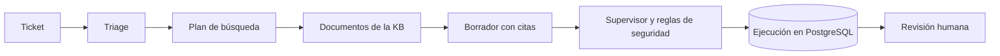

# Informe de entrega: SupportOps

**Fecha:** 28/10/2026

**Estado:** prototipo local funcional; evaluación H5 cerrada. Requiere revisión humana y no está listo para atender clientes reales.

## 1. Objetivo y alcance

SupportOps es una práctica de soporte asistido por IA desarrollada por Cristian y Marco. Permite crear y consultar tickets ficticios, buscar procedimientos en una base de conocimiento, generar un borrador de respuesta y guardar la decisión de una persona que lo aprueba, edita o rechaza. El panel **no envía mensajes al cliente**.

La aplicación se ejecuta localmente con Python, FastAPI, PostgreSQL, Ollama (`qwen2.5:3b`) y Streamlit. El repositorio no incluye despliegue en Docker o AWS. Las credenciales de PostgreSQL se introducen en la terminal y la base de datos local no se publica en Git.

## 2. Funcionamiento

La API permite listar y crear tickets, consultar indicadores, analizar un ticket y recuperar sus ejecuciones. El análisis valida la estructura de las cuatro salidas del modelo y comprueba que las citas correspondan a documentos recuperados. Las reglas de seguridad bloquean pedidos directos de claves o tokens; una ejecución bloqueada solo puede rechazarse. Cada ejecución admite una única revisión humana, guardada con su motivo.

PostgreSQL tiene siete tablas: `clientes`, `tickets`, `eventos`, `documentos`, `relaciones`, `ejecuciones` y `revisiones`. La base de conocimiento entregada contiene **56 documentos y 92 relaciones**. La muestra inicial contiene 3 clientes, 6 tickets y 18 eventos; el generador local puede llevarla a 500 clientes, 20.000 tickets y 60.000 eventos. Todos estos datos son ficticios.

En una corrida local de `eda.py` sobre ese volumen, antes de agregar los casos H5, se observaron 12.001 tickets abiertos (60 %), una mediana de 59 minutos hasta la primera respuesta y una mediana de 205 minutos hasta la resolución. No se detectaron incoherencias de fechas o estados. Estas cifras describen **el conjunto sintético de esa corrida**, no a una empresa real; al agregar tickets nuevos pueden cambiar.

## 3. Verificación realizada

| Prueba | Resultado |
|---|---|
| Pruebas automáticas del código actual | 53 pruebas `unittest`, todas correctas el 28/10/2026. |
| Evaluación de punta a punta H5 | 20 tickets reservados analizados con la API local, Ollama y la base de conocimiento. |
| Categoría esperada en H5 | 14/20. |
| Al menos un documento aceptable, o abstención esperada, en H5 | 9/20. |
| Decisión automática dentro del rango esperado en H5 | 17/20. |
| Los tres criterios simultáneos en H5 | **7/20**. |
| Revisión humana registrada | T01 y T02 rechazados; T03 aprobado; T20 editado. Los otros 16 casos no tienen revisión humana. |
| Casos de error de la API | Se observaron 409 (segunda revisión), 422 (motivo de ejemplo), 503 (modelo inaccesible) y 502 (salida inválida). |

La corrida H5 se hizo con el código posterior al PR #5. Después se ajustó el filtro de secretos para corregir falsos bloqueos; ese cambio tiene pruebas automáticas, pero **no se repitió H5 con el modelo real**. Por eso 7/20 describe la versión evaluada y no debe presentarse como una medición del código actual.

Las 53 pruebas automáticas no necesitan PostgreSQL ni Ollama. Las pruebas H5 y las respuestas HTTP observadas complementan esa verificación con los servicios locales en ejecución.

En las pruebas reales de 502 y 503 se comprobó el código y el mensaje HTTP. No se comparó el número de ejecuciones antes y después de esas llamadas; la ausencia de guardado ficticio está cubierta por pruebas automáticas.

También se evaluó la recuperación por separado con 20 consultas fijadas antes de medir. El acierto en los tres primeros documentos fue 7/15 para búsqueda léxica y 8/15 para grafo e híbrida. Un bandit contextual, medido con cinco semillas, no superó la mejor política fija. Las condiciones y los límites de estas mediciones están en [métricas de recuperación](eval/metricas.md) y [bandit](eval/bandit.md).

## 4. Hallazgos y límites

- La búsqueda léxica no recuperó ninguno de los cinco casos con sinónimos de su evaluación; el grafo prioriza documentos por categoría e ID en vez de seguir las rutas por síntoma.
- En H5 hubo errores de clasificación y documentos de otro problema. Algunos borradores que cumplieron los tres criterios de la planilla todavía necesitaron edición humana.
- La corrección posterior del filtro de secretos reduce dos falsos bloqueos conocidos, pero falta medir su efecto en una nueva corrida con Ollama.
- Los 20.000 tickets generados repiten patrones. Sirven para probar volumen y consultas, pero no para estimar la calidad que habría con clientes reales.
- La API y el panel son locales y no incluyen autenticación, gestión de usuarios ni despliegue preparado para producción. Ningún borrador debe enviarse automáticamente.

## 5. Próximos pasos priorizados

1. Mejorar el ranking de documentos: usar las rutas por síntoma del grafo, cubrir sinónimos y hacer que la búsqueda se abstenga cuando la evidencia no alcance.
2. Corregir las categorías que fallaron en H5 y exigir que el borrador responda al problema concreto sin inventar acciones, reembolsos o procedimientos.
3. Repetir H5 para comparar versiones y preparar **casos nuevos reservados** para comprobar que las mejoras no solo memorizan los 20 ejemplos conocidos.
4. Antes de cualquier uso con datos reales: incorporar autenticación, protección de datos, observabilidad, controles operativos y un proceso de revisión humana. Recién después evaluar Docker y despliegue en la nube.

## 6. Cómo reproducir y consultar la evidencia

El [README](../README.md) contiene la instalación y los comandos para iniciar PostgreSQL, cargar la KB, arrancar la API y abrir el panel. El [informe H5](eval/h5_v2.md) conserva los 20 resultados y las capturas de aprobar, editar y rechazar. Los códigos de error y sus capturas figuran en [pruebas](pruebas.md). La [ficha de datos](ficha_datos.md) describe el origen y las limitaciones del conjunto ficticio.

**Conclusión:** SupportOps demuestra el flujo técnico completo de análisis con evidencia y revisión humana. La evaluación hizo visibles sus fallos y deja una base reproducible para mejorar la calidad. El resultado actual justifica mantenerlo como prototipo supervisado.
